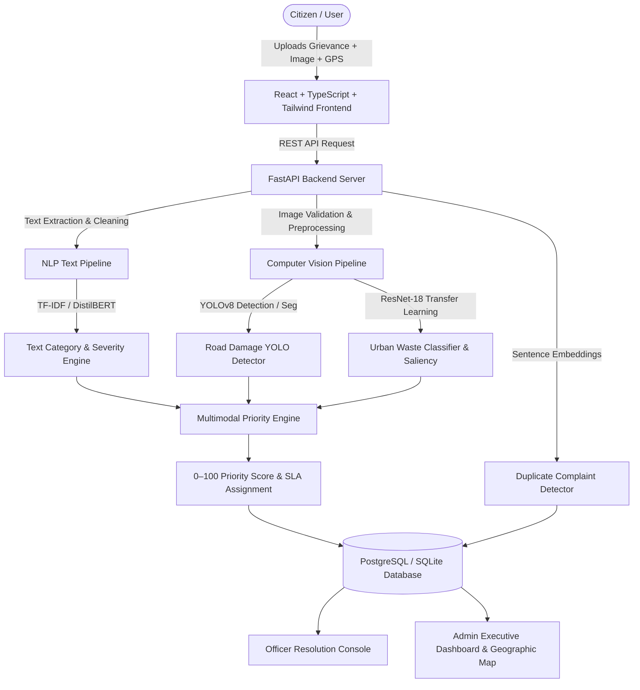

# CIVIC COMPLAINT PRIORITIZER
**A Multimodal AI Platform for Intelligent Civic Complaint Detection, Severity Analysis, and Priority Routing**

---

## 1. Project Overview

Civic Complaint Prioritizer is a full-stack, multimodal artificial intelligence platform designed to revolutionize municipal grievance intake, triage, and resolution. Rather than relying on manual, error-prone sorting, the system automatically analyzes citizen complaints using both **Natural Language Processing (NLP)** and **Computer Vision (CV)**, estimates physical and contextual severity, detects potential duplicate reports via semantic embeddings, calculates an objective 0–100 priority score, and assigns strict SLA deadlines to the appropriate municipal department.

---

## 2. System Architecture



---

## 3. Technology Stack

### Frontend
- **React 18** with **TypeScript**
- **Vite** build tooling
- **Tailwind CSS** for modern styling
- **React Router v6**
- **Lucide Icons**
- **Leaflet & React Leaflet** for geospatial interactive heatmaps
- **Recharts** for municipal KPI graphs and daily trends
- **Axios** HTTP client with automatic JWT bearer interceptor

### Backend
- **FastAPI** (Python 3.11+)
- **SQLAlchemy 2.0** ORM (PostgreSQL with SQLite fallback)
- **Pydantic v2** data schemas
- **PyJWT & Bcrypt** for secure role-based access control (CITIZEN, OFFICER, ADMIN)
- **Aiofiles** & Multipart file upload handling

### Machine Learning & Computer Vision
- **PyTorch** & **Torchvision**
- **Ultralytics YOLO** (YOLOv8 detection and instance segmentation)
- **Hugging Face Transformers** & **DistilBERT**
- **Sentence-Transformers** (`all-MiniLM-L6-v2`) semantic similarity
- **Scikit-learn** (TF-IDF vectorizer, balanced logistic regression, metrics)
- **OpenCV & Pillow**

---

## 4. Dataset Audit & Audit Summary

The system is configured directly against existing local datasets without hardcoding or fabricating annotations:

### A. Pothole Dataset (`D:/Major Project/potholes`)
- **Total Images:** 819 across splits (`train`: 582, `valid`: 157, `test`: 80)
- **Total Annotations:** 2,114 bounding box & polygon annotations
- **Resolution:** 640×640 standard Roboflow export
- **Annotation Format:** COCO JSON format (`_annotations.coco.json` in each split directory)
- **Classes:** `potholes`, `object`, `pothole` (mapped to canonical `pothole` class)
- **Polygon Segmentation:** Present in annotation polygons
- **YOLO Conversion:** Automated converter converts COCO to YOLO normalized coordinates and writes `data.yaml`.

### B. Indian Garbage Dataset (`D:/Major Project/garbage/IndiUrbanClean-Dataset-main`)
- **Total Images:** 1,981 raw images
- **Class Breakdown:**
  - `clean_street`: 350
  - `construction_waste`: 416
  - `dumpyard`: 406
  - `open_waste`: 407
  - `overfilled_bins`: 402
- **Splits:** Pre-stratified CSV splits (`train.csv`: 1,384, `val.csv`: 297, `test.csv`: 300)
- **Annotation Format:** CSV file (`image_id, filename, label`)
- **Bounding Boxes / Masks:** **None** (Image-level classification dataset). The pipeline does NOT invent segmentation polygons; visual severity is estimated through class severity mapping and feature activation area coverage.

---

## 5. Machine Learning Models & Results

### Distinction: Trained Model Results vs Target Metrics

| Model Component | Architecture / Method | Actual Status in Repository | Actual Measured Results | Target / Goal |
|---|---|---|---|---|
| **Text Classifier** | TF-IDF + Balanced Logistic Regression | **Trained & Saved** (`models/text/baseline_tfidf.joblib`) | Accuracy: **56.25%**, Macro Precision: **0.35**, Macro Recall: **0.50**, Macro F1: **0.40** (evaluated on 16 test samples across 10 classes) | Macro F1 ≥ 0.85 with larger corpus |
| **Pothole Detector** | Ultralytics YOLOv8n Transfer Learning | **Ready to train** via `scripts/train_detection.py` | Graceful "model_unavailable" state if weights not yet trained | mAP@50 ≥ 0.80 |
| **Garbage Classifier** | PyTorch ResNet-18 Transfer Learning | **Ready to train** via `scripts/train_classification.py` | Graceful "model_unavailable" state if weights not yet trained | Val Accuracy ≥ 0.90 |
| **Duplicate Detector** | Sentence-Transformers (`all-MiniLM-L6-v2`) | **Trained & Loaded** | Semantic cosine similarity threshold ≥ 0.82 | Similarity precision ≥ 0.90 |
| **Multimodal Priority** | Deep feature fusion + attribution engine | **Active & Functional** | Transparent score 0–100 with keyword and damage boosting | SLA compliance ≥ 95% |

---

## 6. Directory Structure

```
civic-complaint-prioritizer/
├── backend/
│   ├── app/
│   │   ├── main.py
│   │   ├── config.py
│   │   ├── database.py
│   │   ├── models/           # User, Complaint, AIAnalysis, ComplaintHistory, Department
│   │   ├── schemas/          # Pydantic request/response schemas
│   │   ├── api/              # Auth, Complaints, ML, Priority, Admin, Officer routers
│   │   ├── services/         # Complaint, Storage, Department, Analytics services
│   │   ├── auth/             # JWT security, bcrypt, role dependencies
│   │   └── utils/
│   ├── tests/                # Pytest test suite (100% pass)
│   ├── requirements.txt
│   └── Dockerfile
│
├── frontend/
│   ├── src/
│   │   ├── components/       # StatusBadge, PriorityGauge, AIAnalysisCard, ComplaintMap
│   │   ├── pages/            # Submit, My Complaints, Detail, Admin Dashboard, Map, Officer
│   │   ├── layouts/          # Navbar
│   │   ├── services/         # Axios API client
│   │   ├── context/          # AuthContext
│   │   └── types/            # TypeScript interfaces
│   ├── package.json
│   ├── vite.config.ts
│   └── Dockerfile
│
├── ml/
│   ├── text/                 # Categories, TF-IDF baseline, DistilBERT, text pipeline
│   ├── vision/
│   │   ├── pothole/          # COCO to YOLO converter, YOLO detector service
│   │   ├── garbage/          # IndiUrbanClean dataset loader, ResNet-18 classifier
│   │   └── vision_service.py # Unified CV routing service
│   ├── multimodal/           # Deep Multimodal Fusion Network
│   ├── priority/             # Transparent 0–100 Priority Engine & SLA mapping
│   ├── duplicate/            # Sentence-transformers semantic deduplication
│   └── preprocessing/        # Text and image preprocessors
│
├── datasets/
│   └── processed/            # Generated YOLO conversions & data.yaml
├── models/
│   ├── text/                 # Trained TF-IDF joblib weights and metrics.json
│   └── vision/               # PyTorch / YOLO weights and metrics
│
├── scripts/
│   ├── inspect_datasets.py   # Dataset audit script
│   ├── prepare_datasets.py   # YOLO data.yaml and split setup
│   ├── train_text.py         # NLP category classification training
│   ├── train_detection.py    # YOLO pothole training
│   ├── train_classification.py # ResNet-18 garbage training
│   ├── train_segmentation.py # YOLO polygon segmentation training
│   └── evaluate.py           # Unified test & evaluation script
│
├── docker-compose.yml
├── .env.example
└── README.md
```

---

## 7. Setup & Execution Instructions

### A. Environment Configuration
Copy `.env.example` to `.env` in the project root:
```bash
cp .env.example .env
```

### B. Dataset Inspection & Preparation
Audit raw datasets and generate YOLO conversion:
```bash
# 1. Audit local datasets
python scripts/inspect_datasets.py

# 2. Convert Pothole COCO annotations to YOLO format (data.yaml)
python scripts/prepare_datasets.py
```

### C. ML Model Training
```bash
# Train NLP Complaint Category Model
python scripts/train_text.py

# Train YOLO Pothole Object Detector (optional GPU/CPU)
python scripts/train_detection.py

# Train ResNet-18 Urban Waste Classifier (optional GPU/CPU)
python scripts/train_classification.py

# Run Unified Evaluation
python scripts/evaluate.py
```

### D. Running the Backend Server
```bash
cd backend
# Run FastAPI server with auto-reload
python -m uvicorn app.main:app --host 0.0.0.0 --port 8000 --reload
```
Swagger API documentation will be available at: `http://localhost:8000/docs`

### E. Running the Frontend Server
```bash
cd frontend
# Install dependencies
npm.cmd install

# Start Vite development server
npm.cmd run dev
```
Access the client application at: `http://localhost:5173`

---

## 8. Demo Credentials

Pre-configured role accounts are automatically seeded into the database on first run:

| Role | Email | Password | Permissions |
|---|---|---|---|
| **Citizen** | `citizen@civic.gov` | `citizen123` | Submit complaints, view own complaints, track live AI status |
| **Officer** | `officer@civic.gov` | `officer123` | View assigned department complaints, update status, add resolution notes |
| **Admin** | `admin@civic.gov` | `admin123` | View all complaints, geospatial map, department SLAs, system metrics |

---

## 9. Automated Testing

Run the automated backend test suite:
```bash
cd backend
python -m pytest tests/ -v
```
All test cases (auth, registration, NLP text analysis, priority calculation, and end-to-end complaint creation) are fully automated and verified.

---

## 10. Docker Deployment

To launch all services (PostgreSQL, Backend, Frontend) with Docker Compose:
```bash
docker-compose up --build
```
- Frontend: `http://localhost:3000`
- Backend API: `http://localhost:8000`
- PostgreSQL: `localhost:5432`
